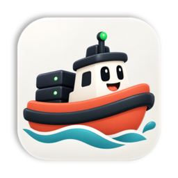
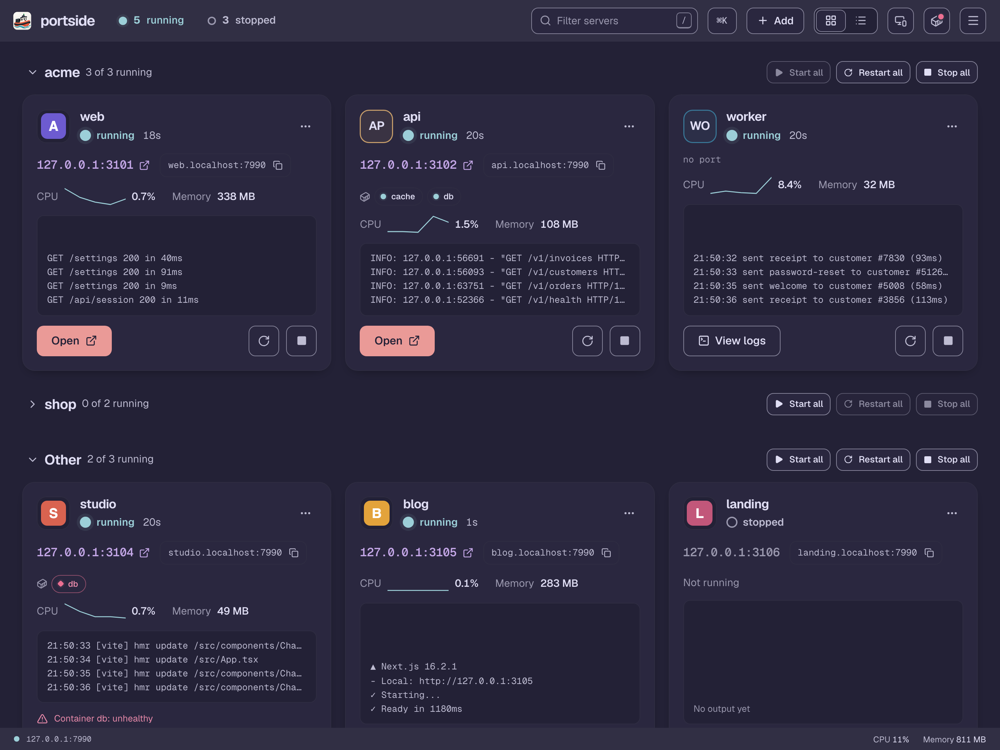
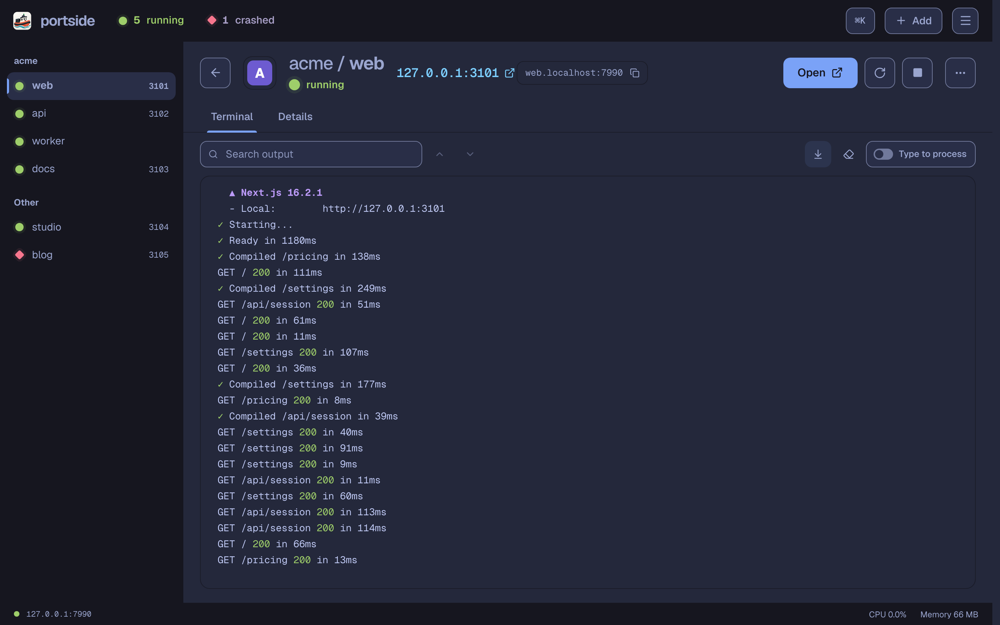
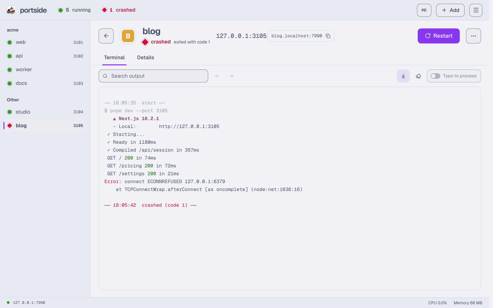
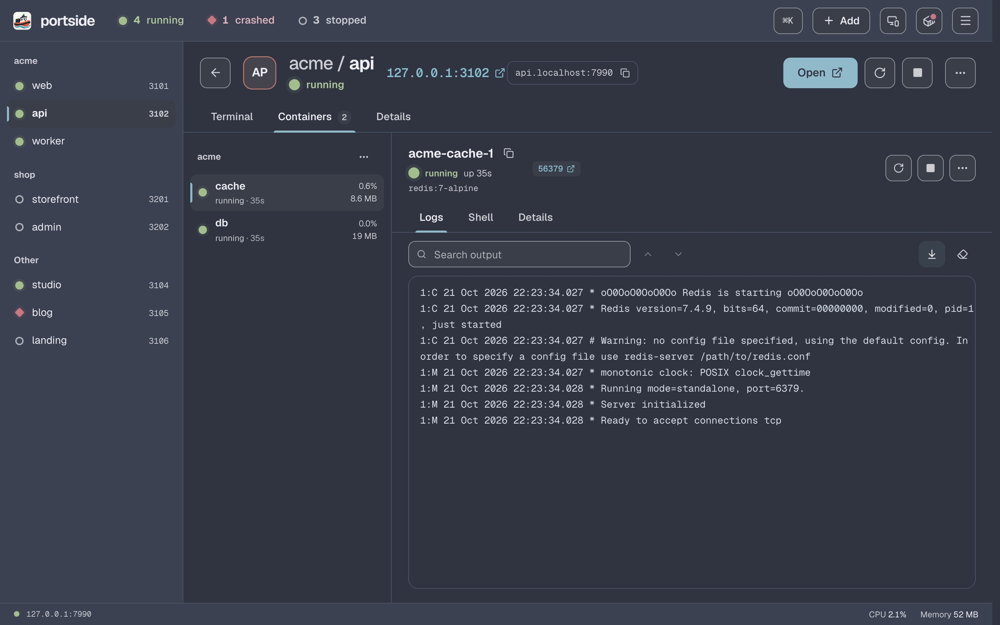
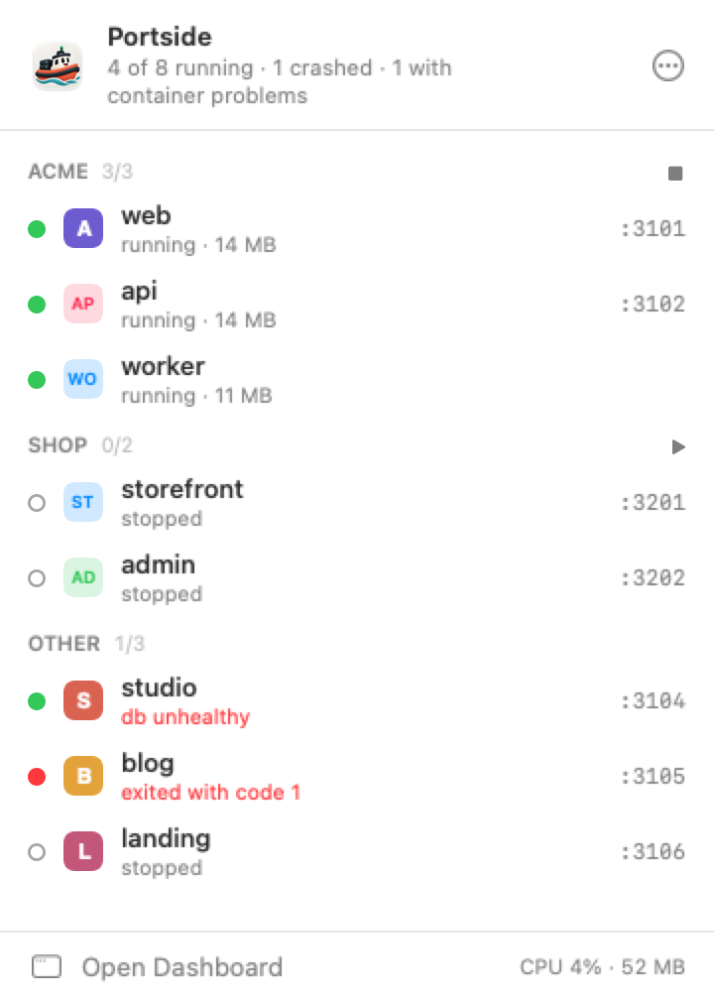
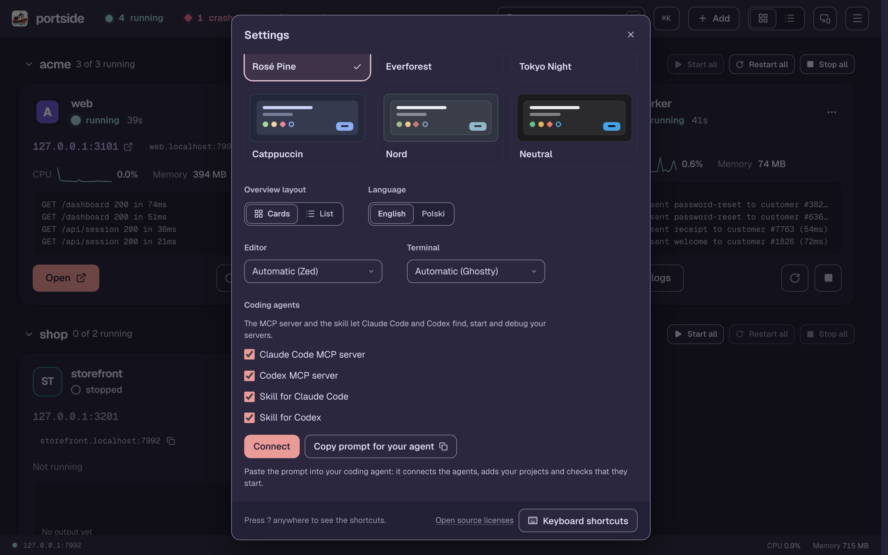

<p align="center">
  
</p>

<h1 align="center">portside</h1>

<p align="center">Keep your local dev servers running, in one place.</p>

<p align="center">
  <a href="https://github.com/padmk/portside/releases/latest"></a>
  
  <a href="LICENSE"></a>
</p>

<p align="center">
  
</p>

Portside is a menu bar app, a CLI and a web dashboard for the dev servers you run every day: Next.js, Vite, Python APIs, `docker compose` stacks, workers. It starts them in real terminals, keeps their ports stable and shows status, logs and resource use on one calm page. Coding agents use the same servers through MCP, so they reuse a running server and read its logs instead of starting a duplicate on a random port and losing track of it.

One static binary, no runtime dependencies, no account, no telemetry, and nothing leaves `127.0.0.1` unless you turn on sharing with your other computers.

## Highlights

- **One list for every project.** A single TOML file describes servers across all your repositories, with groups (`portside up shop`) and dependencies (`api` waits for `db`). `portside scan` finds Node, Deno, Python, Ruby, PHP, Elixir, Java, .NET, Go, Rust and Compose projects and proposes the commands.
- **Stable ports and clean URLs.** Each server keeps its port and is also reachable at `http://<name>.localhost:7878`, WebSockets and hot reload included.
- **Real terminals, honest status.** Servers run in a PTY with live output, search and `portside attach`. `starting` lasts until the port answers, crashes show the exit code, and foreign processes holding a port are named.
- **Survives restarts and updates.** Restart policies with backoff, crash notifications, and servers that keep running through a daemon upgrade or come back after a reboot.
- **Containers.** Compose containers appear next to their server with state, health, logs, a shell and recreate, for Docker Desktop, OrbStack, Colima, Podman and remote engines.
- **Coding agents.** An MCP server and a skill for Claude Code, Codex and other MCP clients: `ensure_server` starts a server if needed and returns its URL, agents read logs instead of guessing, and `--read-only` limits them to looking.
- **Other computers.** Over Tailscale, drive the servers of another of your machines and open its sites locally.

<table>
  <tr>
    <td></td>
    <td></td>
  </tr>
  <tr>
    <td colspan="2"></td>
  </tr>
  <tr>
    <td><picture><source media="(prefers-color-scheme: dark)" srcset="design/screenshots/menubar-dark.png"></picture></td>
    <td></td>
  </tr>
</table>

## Install

Requires macOS 26 (Tahoe) or later on Apple Silicon. With Homebrew, this installs `Portside.app` and the `portside` command:

```sh
brew install --cask padmk/tap/portside
```

The app is not notarized by Apple yet, and the cask removes the quarantine flag so that macOS lets it start. You rely on the public source and on release files built by GitHub Actions with a verifiable attestation instead; [Trust](docs/security.md#trust) says what that covers and how to check a download, or build it from source as below.

<details>
<summary>Other ways to install, update and uninstall</summary>

**Download.** Get `Portside-<version>.zip` from the [releases](https://github.com/padmk/portside/releases), move `Portside.app` to Applications, and choose **Settings > Install Command Line Tool** in its menu. The app is signed ad hoc and not notarized, so macOS blocks the first launch of a downloaded copy: open it once, then choose **Open Anyway** in **System Settings > Privacy & Security** and confirm ([Apple's instructions](https://support.apple.com/en-us/102445)). The Homebrew cask clears the quarantine flag itself.

**Linux (preview).** The CLI, daemon and dashboard run on x86-64 and arm64, but macOS is the platform Portside is built and tested for. Download `portside_<version>_linux_<arch>.tar.gz` from the releases, put `portside` on your `PATH`, and run `portside service install` to start the daemon at login.

**From source** (Go 1.26+, Node 24 and pnpm 12):

```sh
git clone https://github.com/padmk/portside
cd portside
make install            # builds the dashboard and installs ~/.local/bin/portside
make app-install        # macOS: builds Portside.app and installs it in /Applications
```

**Browser.** The dashboard is served at its own `*.localhost` host, so it needs a browser that resolves `*.localhost`: Chrome, Firefox, or Safari on macOS 26 and later (the app's dashboard window uses the same WebKit).

**Updating.** `make app-install` quits a running copy, installs the new one, upgrades a running daemon to the new binary in place and reopens the app. After any other update (Homebrew, a release download, `make install`), run `portside daemon restart` with the new binary; the app's **Restart** banner, shown when the daemon's version differs from the app's, does the same. Servers keep running through the update.

**Uninstalling.** First stop the daemon and its servers with `portside daemon stop` (or `portside service uninstall` if you installed the login service, which also stops it). `brew uninstall` and `brew upgrade` leave them running; `brew uninstall --zap --cask portside` stops them and trashes the config and state.

</details>

## Quick start

On macOS, open Portside: its first window offers to find your projects and connect your coding agents. From the terminal:

```sh
portside scan --add     # find projects in your projects folder and add them
portside up web --wait  # start one server and wait until it is ready
portside open           # sign in and open the dashboard
portside setup          # connect Claude Code and Codex
```

Any command starts the daemon on demand, so there is nothing to launch first. Servers live in `~/.config/portside/portside.toml`:

```toml
root = "~/dev"

[servers.web]
dir = "shop/apps/web"
cmd = "pnpm dev --port {PORT}"
port = 3001
group = "shop"
```

## Documentation

- [Configuration](docs/configuration.md): every key, the environment and version managers, the daemon's port, project discovery
- [CLI](docs/cli.md): every command
- [Dashboard and menu bar app](docs/dashboard.md)
- [Coding agents](docs/coding-agents.md): setup, other MCP clients, the tools, worktrees
- [Containers](docs/containers.md): engines, ownership, actions
- [Other computers](docs/other-computers.md): pairing and sharing over Tailscale, or with your coding agent's help
- [How it works](docs/how-it-works.md): processes, state, upgrades in place, the login service
- [Security model](docs/security.md): what Portside can do as you, what agents can do, how to verify a release
- [Compared with other tools](docs/comparison.md): process-compose, pitchfork, Portless, WhatThePort, Overmind
- [Development](docs/development.md) and the [changelog](CHANGELOG.md)

## License

[MIT](LICENSE). Third-party licenses are listed in `THIRD_PARTY_NOTICES.txt`. Report vulnerabilities as described in [SECURITY.md](SECURITY.md).
