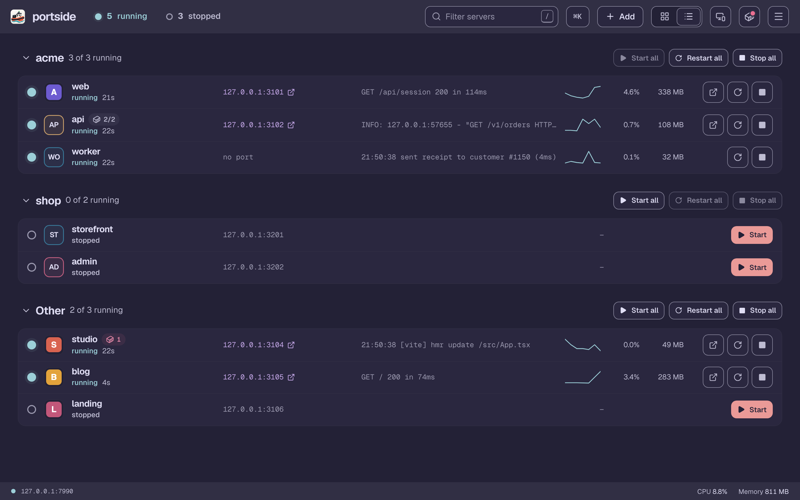
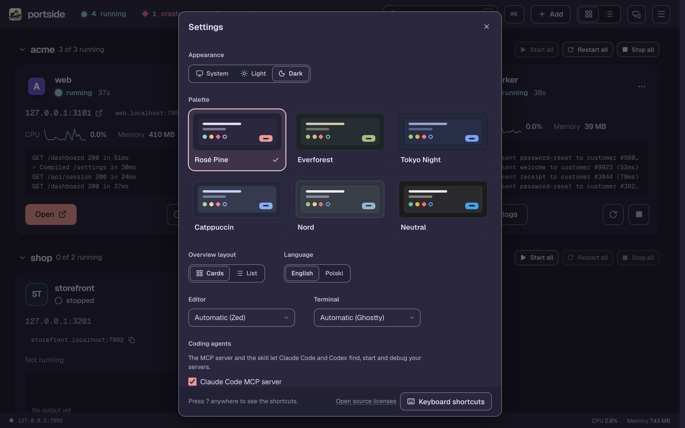

# Dashboard and menu bar app

## Menu bar app (macOS)

The status icon shows whether everything runs, something is starting, or a server or one of its containers needs attention. Its panel lists every server with its project icon and start, stop, restart, open and logs, plus group actions; the dashboard opens in its own window.

A crash arrives as a notification with **Restart** and **Show Logs** once the restart policy gives up: one per crash, not one per attempt. A container that turns unhealthy or fails sends one too. More in [How it works](how-it-works.md#the-macos-app).

## Dashboard

The layout follows the number of servers: one server fills the screen with its output and charts, a few get large cards with a live log preview, and long lists switch to compact rows. `c` and `l` choose cards or the list yourself. Click a server for a full-size terminal, with every server one click away in a side rail. Group headers start, restart (in dependency order) and stop a whole group.

Everything else (ports, config, adding servers) is in the menu and the command palette: `⌘K` on macOS, Ctrl+Shift+Space elsewhere. `?` lists the keyboard shortcuts.

Servers run in a PTY, so colors, progress bars and interactive prompts work. Type into a server's terminal in the dashboard, or attach from your own terminal with `portside attach web` and detach with `Ctrl-]`.

In the terminal view:

- `⌘F` (Ctrl+Shift+F elsewhere, so Ctrl-F and Ctrl-K stay with the shell) searches the terminal.
- **Filter lines** shows the matching lines from all the output the daemon keeps.
- **Clear output** clears only this view. **Clear daemon scrollback** in the server menu forgets the kept output; the log file stays, and **Open log file** shows it.

CPU and memory are shown per server, summed over its whole process tree, with sparklines.

## Server states

- `starting` until the port accepts connections, the `health` path answers and the `ready_log` line appears, whichever are configured.
- `running`.
- **not responding** (an amber diamond; an orange light in the menu bar) when a running server has stopped answering on its port or `health` path for 4 seconds, with the reason. It is not restarted, and `portside check` reports it.
- `stopping` and `stopped`.
- `exited` when the process ended on its own with code 0.
- `crashed` with the exit code.
- `blocked` when another process holds the port.
- `external` for a stopped server whose port a program Portside did not start holds. The dashboard names that program, and you can take the port over in one click.

With a restart policy (`on-failure` or `always`, exponential backoff), a server waiting for its next automatic restart can be stopped like a running one.

A running server or container port that listens on the network, not only on loopback, is marked **May be reachable from the network**; click the mark for the fix ([Security](security.md#servers-reachable-from-the-network)).

## Ports overview

Every listening TCP port on the machine with its process and working directory, and the container a published port belongs to. Strays can be killed from here; [Security](security.md#killing-processes) says which processes may be.

## Themes

Rosé Pine (default), Everforest, Tokyo Night, Catppuccin, Nord and a neutral palette, each in light and dark, following the system setting or your choice. The terminal follows the theme. **Settings** also holds the layout, the language, and the editor and terminal the dashboard opens.

